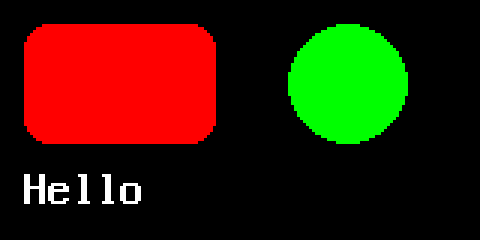

# pygraphics

pygraphics is the part of OmniPython that draws: shapes, text and images into
a framebuffer, with the same code on MicroPython-compatible boards,
CircuitPython-compatible boards and CPython.

```bash
pip install -i https://test.pypi.org/simple/ --extra-index-url https://pypi.org/simple/ pydevices-pygraphics
```

```python
import mip
mip.install("pygraphics", index="https://PyDevices.github.io/mip")
```

```python
import pygraphics
from pygraphics import FrameBuffer, RGB565

fb = FrameBuffer(bytearray(160 * 80 * 2), 160, 80, RGB565)
fb.fill(0x0000)
card = fb.round_rect(8, 8, 64, 40, 8, 0xF800, f=True)
dot = fb.circle(116, 28, 20, 0x07E0, f=True)
label = pygraphics.text16(fb, "Hello", 8, 56, 0xFFFF)
print("changed:", card + dot + label)
fb.save("hello.bmp")
```

```text
changed: Area(8, 8, 128, 64)
```

`hello.bmp` is the picture at the top of this page, shown at three times its
size.

[Docs](https://pygraphics.readthedocs.io) · [Examples](https://pydevices.github.io/pydevices-examples/pyscript/) · [Roadmap](ROADMAP.md)

OmniPython is made by [PyDevices](https://pydevices.com).
